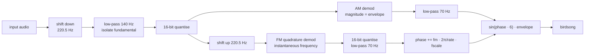
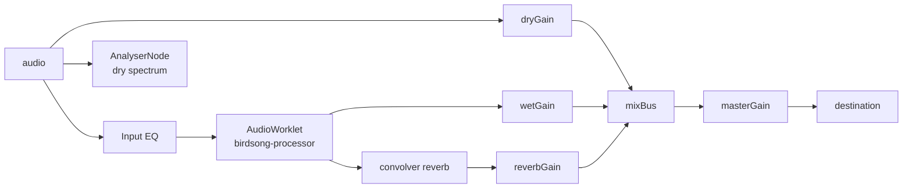

# Speech to Birdsong converter

Turn a recording of speech into the song of a blackbird.

This project is a recreation of [windytan's `blackbird.pl`](https://gist.github.com/windytan/80781ca72c357bb61de8a7b70faea48f)
and the accompanying blog post, ["Speech to birdsong conversion"](https://www.windytan.com/2021/03/speech-to-birdsong-conversion.html).

An `AudioWorklet` DSP is faithful to the original Perl/sox/csdr chain — filter taps,
gains, the FM discriminator constant and the 16-bit grit — and then
extends it with a continuous pitch control, an additive timbre/waveform engine,
runtime tracker tuning, separate envelope/pitch response, a trill LFO, species
presets, per-slider auto tuning and a randomizer.

|           | Web app                                                           |
| --------- | ----------------------------------------------------------------- |
| Runs on   | Any browser with `AudioWorklet`                                   |
| DSP       | Rust/WASM core (`wasm/src/lib.rs`) loaded from `public/worklets/` |
| Front end | Astro static page (`src/pages/index.astro`)                       |

---

## Quick start

```bash
npm install
npm run dev        # http://localhost:4321
```

Then drop in an audio or video file and press Play. `npm run build` produces a
static site in `dist/` that can be hosted anywhere.

The DSP runs in a Rust/WASM AudioWorklet. An earlier JavaScript implementation
is kept as a fallback if the wasm cannot be loaded, for whatever reasons. The compiled
`public/worklets/birdsong-processor.wasm` is committed, so normal builds do not
need Rust. Rebuild it after changing the Rust core with `npm run wasm` (requires
Rust and `rustup target add wasm32-unknown-unknown`).

---

## How it works

The core idea, from windytan's post: a voice is a harmonic stack, so if you
can track its instantaneous fundamental frequency `F0` and its amplitude
envelope, you can throw away the original harmonics and resynthesise a single
tone that follows the same inflections — just much higher. The result sounds
like a bird because birdsong and intonation share the same frequency-sweep
vocabulary.



Step by step:

1. **Duplicate to I/Q.** The mono (or down-mixed) input is treated as a
   complex signal with `I = Q = sample`. Multiplying a real signal by
   `(1 + j)` rotates it 45° and adds nothing audible; FM and AM demodulation
   are invariant to it, so this is harmless.

2. **Shift down by 220.5 Hz.** A complex mixer (`csdr shift_math_cc`)
   translates the spectrum so the fundamental — normally 80–350 Hz — lands
   near 0 Hz, i.e. at baseband. In the web app this shift is the *Voice range*
   control, so it can be moved onto lower or higher voices.

3. **Low-pass at 140 Hz (SoX `sinc`, 1025 taps).** This keeps the fundamental
   around DC and rejects most harmonics. What remains is an analytic,
   single-sideband complex tone whose phase tracks `F0`.

4. **16-bit quantisation.** The original wrote intermediate WAVs as 16-bit
   PCM, which adds a small amount of noise. That noise is part of the
   character (the little trills in the original) and is reproduced here
   (the *16-bit grit* toggle disables it).

5. **AM demodulation.** `sqrt(I² + Q²)` gives the amplitude envelope, low-pass
   filtered at 70 Hz.

6. **FM quadrature demodulation.** The shift is undone, then:
   `fm[n] = K · Im(x[n]·conj(x[n-1])) / |x[n]|²`, with
   `K = 0.340447550238101…` (the exact constant from `csdr`). This is the
   instantaneous frequency of the tracked fundamental.

7. **Resynthesis.** The phase accumulator is advanced by
   `fm · 2π/rate · fscale`, and the output is `sin(6·phase) · envelope`.
   In the original, `fscale = 24000` and the fixed output harmonic is `6`; the
   web app folds that `6` into a `BASE_HARMONIC` constant and exposes a
   continuous *Pitch*, then optionally sums further harmonics of that tone
   (the *Timbre* and *Wave* controls) for non-sine timbres.

### The pitch factor

For a steady tone the output frequency is proportional to the input `F0`:

```
out_hz ≈ 6 · K · (2π · fscale / rate) · G · F0
```

where `G` is the DC gain of the 70 Hz low-pass filter. A subtlety worth
knowing: SoX's `sinc` effect does not normalise the filter's DC gain, and an
under-designed 70 Hz / 1025-tap Kaiser filter has `G ≈ 0.854`. So the real
pitch factor of the original is about **5.96×**, not the naive 6.99×, and the
worklet reproduces that exactly.

### Faithful DSP details

- All filters are Kaiser-windowed sinc low-passes generated by the exact
  `lsx_kaiser_params` / `lsx_make_lpf` algorithm from SoX, including its
  coefficient table and clamping; the equivalent code lives in the worklet.
- The FM discriminator constant, the complex mixer convention, and the AM
  demodulator are taken verbatim from `libcsdr.c`.
- FM/AM paths each pass through exactly one 70 Hz filter, so they stay
  sample-aligned.
- The browser worklet adapts to the device sample rate: the frequency shift is
  kept at 220.5 Hz and `fscale` is scaled by `sampleRate / 44100`, so the
  result is identical on 44.1 kHz and 48 kHz hardware.

---

## Web app controls

| Control                        | What it does                                                                                                                                                                                                                                                                                                                                                                                                                                                                                                               |
| ------------------------------ | -------------------------------------------------------------------------------------------------------------------------------------------------------------------------------------------------------------------------------------------------------------------------------------------------------------------------------------------------------------------------------------------------------------------------------------------------------------------------------------------------------------------------- |
| **Drop zone / Choose a file**  | Load an audio or video file. You can drop it anywhere on the page — a dashed overlay appears while dragging. Everything is local; nothing is uploaded.                                                                                                                                                                                                                                                                                                                                                                     |
| **Video panel**                | Appears when the file has a video track. The video plays in sync and its audio is routed through the converter; clicking the video toggles play/pause.                                                                                                                                                                                                                                                                                                                                                                     |
| **Input spectrum**             | Live spectrum of the input voice, drawn on the **same 20 Hz–20 kHz log-frequency axis as the EQ**, as the backdrop of the scope. It taps the media source directly, so it is unaffected by the EQ, Voice/Bird mix, reverb or volume. The scope legend labels the bars "input voice" and the curve "EQ curve".                                                                                                                                                                                                              |
| **« 10s / progress / 10s »**   | Seek bar and skip buttons. Drag to scrub anywhere.                                                                                                                                                                                                                                                                                                                                                                                                                                                                         |
| **Play / Pause**               | Starts or pauses the media element. <kbd>Space</kbd> does the same whenever no button, link or form control has focus.                                                                                                                                                                                                                                                                                                                                                                                                     |
| **Stop**                       | Pauses, rewinds to the start, and resets the converter's filter state.                                                                                                                                                                                                                                                                                                                                                                                                                                                     |
| **Volume**                     | Master listening volume (0–100%), shown as a triangular fill bar. Purely a monitoring level; it does not affect the export or the visualizer and is never randomized.                                                                                                                                                                                                                                                                                                                                                      |
| **Record**                     | Microphone button after the volume slider. The first click asks for microphone permission and starts recording (the button pulses red while capturing); the next click stops, turns the take into a media file and starts playing it, so it can be converted and exported like any dropped file. While recording, the player spectrum and the input spectrum show the live microphone and a red "recording" badge sits in the player corner. Nothing leaves the browser.                                                   |
| **Make WAV / Download WAV**    | Two-phase so the UI never blocks. Clicking **Make WAV** renders the converted birdsong offline through the same worklet and encodes it into memory; the button turns into a progress bar (render %, then encode %) and finally becomes a highlighted **Download WAV**. Clicking that saves the prepared 16-bit WAV instantly. Any change to the conversion params or EQ resets it back to "Make WAV". Enabled only if the browser can decode the file's audio.                                                             |
| **Make MP3 / Download MP3**    | Same two-phase flow, encoding a 160 kbps mono MP3 in memory (chunked with yields, so the UI stays responsive). Turns white to **Download MP3** when ready.                                                                                                                                                                                                                                                                                                                                                                 |
| **Voice / Bird**               | Crossfades between the input voice (0%) and the birdsong (100%). Default 100% bird.                                                                                                                                                                                                                                                                                                                                                                                                                                        |
| **Reverb**                     | Send level to a synthetic convolution reverb (a decaying-noise impulse response) for a forest ambience. Default 15%.                                                                                                                                                                                                                                                                                                                                                                                                       |
| **Settings → Pitch**           | Continuous output transposition. The slider shows the bird-to-voice ratio (about 6× at the default), so the raw internal value stays out of the way. Range 2000–80000 (0.5×–19.9×).                                                                                                                                                                                                                                                                                                                                        |
| **Settings → Timbre**          | How many overtones of the resynthesised tone are summed (1–12). 1 is a clean whistle; higher values get buzzier and more textured.                                                                                                                                                                                                                                                                                                                                                                                         |
| **Settings → Wave**            | The overtone recipe Timbre counts up: `sine` (fundamental only), `triangle` and `square` (odd overtones), or `saw` (all overtones, 1/k). Overtones are band-limited to Nyquist per sample to limit aliasing.                                                                                                                                                                                                                                                                                                               |
| **Settings → Trill depth**     | Adds a fast pitch vibrato (0–100%). At zero the output follows the voice's own inflections exactly.                                                                                                                                                                                                                                                                                                                                                                                                                        |
| **Settings → Trill rate**      | How fast the trill vibrato runs (4–30 Hz).                                                                                                                                                                                                                                                                                                                                                                                                                                                                                 |
| **Settings → Voice range**     | The tracker's frequency shift in Hz (80–600, default 220). The tracked window is roughly `shift ± roughness`, so this picks which input pitch is followed. Lower it for deep voices; raise it to track an overtone or a high singer. Presets leave this control alone so they do not break the speaker fit; Randomize changes it only when its **to randomize** box is ticked (on by default).                                                                                                                             |
| **Settings → Roughness**       | The tracker's low-pass cutoff (60–300 Hz, default 140). Wider lets more overtones leak into the FM path, giving rougher, more trilled birds; narrower is cleaner.                                                                                                                                                                                                                                                                                                                                                          |
| **Settings → Noise gate**      | Soft squelch, applied to the output as `gain = env / (env + gate)`. Higher values mute low-level hiss between phrases. Shown as a percentage in the UI; default off (0%).                                                                                                                                                                                                                                                                                                                                                  |
| **Settings → Pitch response**  | How closely the bird follows quick pitch changes (20–200 Hz, default 70). Low smooths the melody into long glides; high preserves fast wobbles.                                                                                                                                                                                                                                                                                                                                                                            |
| **Settings → Volume response** | How quickly the bird's loudness follows the voice (20–200 Hz, default 70). Low is smooth and legato; high is choppy and precise.                                                                                                                                                                                                                                                                                                                                                                                           |
| **Settings → Auto volume**     | A slow automatic level control on the tracked envelope, so quiet recordings still produce loud birds. On by default.                                                                                                                                                                                                                                                                                                                                                                                                       |
| **Settings → Lo-fi grit**      | Enables the 16-bit intermediate quantisation that adds a little digital fuzz and texture. On by default.                                                                                                                                                                                                                                                                                                                                                                                                                   |
| **Settings → presets**         | Icon buttons for Blackbird / Warbler / Canary / Sparrow / Owl. They set the bird character (pitch, timbre, wave, trill, response, roughness, gate, reverb) but deliberately leave **Voice range** alone, because that is a property of the speaker. The selected preset glows until any sound setting changes.                                                                                                                                                                                                             |
| **Settings → auto buttons**    | Each slider that can be inferred from the recording has a small **auto** button next to its value: **Pitch** (puts the detected voice in a bright bird register), **Voice range** (centres the tracker on the detected voice), **Roughness** (sets a tracking width from the detected pitch spread) and **Noise gate** (uses the recording's noise floor). The first click analyses the decoded file once; later autos reuse the cached result. The detected median and range are logged to the console.                   |
| **Settings → Randomize**       | Reads the **to randomize** checkboxes on the right of each row and shuffles only those controls. By default every sound control except **Voice / Bird** is enabled, including **Voice range** (useful for music/noise), plus the EQ via its **randomize EQ** checkbox. Master volume, Auto volume and Lo-fi grit are never randomized. If every box is unticked, Randomize explains that instead of doing nothing silently.                                                                                                |
| **Input EQ**                   | A freehand, continuous EQ from 20 Hz–20 kHz, ±12 dB, drawn directly over the live spectrum on one canvas (legend included). The curve is sampled onto a dense bank of peaking filters (128 log-spaced bands), so you can draw any shape: drag anywhere to paint, sweep sideways to draw across frequencies in one gesture. Shapes what the converter hears, not the input voice, and is applied to the WAV export too. Has an on/off toggle, a **randomize EQ** checkbox (whether Randomize shuffles the curve) and Reset. |

### Preset notes

The presets are characters, not species identification. The output fundamental is
`input Hz × pitch × 2.4853e-4`, so the absolute pitch always depends on the
speaker. The table below uses a 180 Hz speaking voice as a reference; a typical
adult voice moves roughly 110–220 Hz, so the real output moves with it.
**Voice range** is not part of a preset: use its auto button (or set it
manually) to fit the speaker first.

### Web audio graph



The uploaded media element is the single source of truth for playback, so
seek, loop and A/V sync are handled natively. Its audio is captured with
`createMediaElementSource` and fed to the dry path, the EQ/converter, and a
silent analyser tap (a zero-gain sink keeps it processed without any audible
contribution). The element itself is never heard directly. Because the
analyser taps before the EQ, the scope always shows the untouched dry input.

---

## Project layout

```
wasm/src/lib.rs                          # Rust DSP core (primary engine)
public/worklets/birdsong-processor.wasm  # compiled core, committed
public/worklets/birdsong-processor-wasm.js # AudioWorklet wrapper for the core
public/worklets/birdsong-processor.js    # optimized JS fallback engine
src/pages/index.astro                    # web UI, audio graph and controls
specimen/                                # example inputs
```

## Development

```bash
npm run dev        # dev server (http://localhost:4321)
npm run build      # static build to dist/
npm run preview    # serve the built site
npm run thumbnails # regenerate example card thumbnails (requires ffmpeg)
```

## Credits

- Original concept, `blackbird.pl` and blog post:
  Oona Räisänen (windytan), 2021.
- DSP primitives derived from [csdr](https://github.com/ha7ilm/csdr)  and  [SoX](https://sox.sourceforge.net/).
- Browser MP3 export uses [@breezystack/lamejs](https://www.npmjs.com/package/@breezystack/lamejs).
- Visualizer is [ShowCQT](https://github.com/mfcc64/showcqt-js)
- The wacky spike-growing interface is my [Biomorphic UI](https://github.com/MitPitt/biomorphic-ui) experiment.
